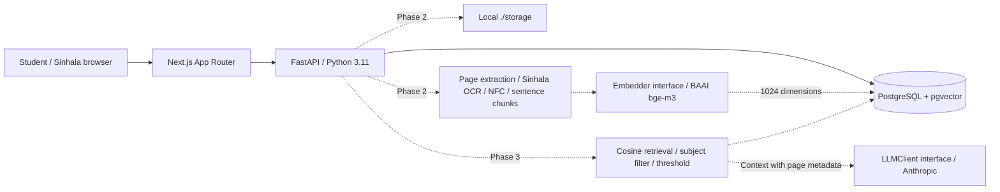

# අකුර · Sinhala study assistant

A Sinhala-only study workspace for answers grounded in uploaded notes and past papers, with document and page citations. There is no authentication: the intended scope is one shared, trusted workspace.

**Current scope: Phase 1 foundation.** The database, migrations, API readiness endpoint, and Sinhala interface are implemented. Automated checks pass; visual browser acceptance is pending because this session's browser and native UI services are unavailable. Phase 2 remains gated. Upload, retrieval, chat, quizzes, voice, and evaluation belong to subsequent phases; the overview describes the intended workflow and does not show fabricated documents or answers.

> Demo GIF placeholder: add `docs/demo.gif` after the real upload → chat workflow passes browser acceptance.

## Architecture



Solid lines are implemented in Phase 1. Dotted lines are planned.

## Quickstart

Prerequisites: Docker Desktop with the Linux engine running and Docker Compose v2.24+ (or v5). No local Python installation, database installation, or API keys are required for Phase 1.

From this repository root, in PowerShell:

```powershell
Copy-Item .env.example .env
# Edit .env and choose a unique POSTGRES_PASSWORD.
# Update DATABASE_URL to match if you use local Python commands.
docker compose up --build -d --wait
Invoke-RestMethod http://localhost:8000/health
```

On macOS/Linux, use `cp .env.example .env` and `curl http://localhost:8000/health` instead. Open **http://localhost:3000**. Health returns `{"status":"ok","database":"ok"}` only when PostgreSQL, pgvector, and the Alembic schema are available. API documentation is at http://localhost:8000/docs in development.

The first build downloads images and npm/Python dependencies. Sinhala fonts are bundled in the frontend through Fontsource, so the browser and production build do not need Google Fonts access. Database data lives in the `postgres_data` named volume. Uploaded files will live in `./storage`, which is ignored by Git.

```powershell
docker compose ps
docker compose logs --tail 60 backend
docker compose stop
# Stops/removes containers while preserving data:
docker compose down
```

Do not use `docker compose down -v` unless you intend to delete the database volume. Changing `POSTGRES_PASSWORD` after initialization does not change an existing database user's password.

### Ports and environment

| Variable | Default | Purpose |
| --- | --- | --- |
| `POSTGRES_PORT` | `55432` | Loopback host database port; container uses 5432 |
| `BACKEND_PORT` | `8000` | Loopback API port |
| `FRONTEND_PORT` | `3000` | Loopback web port |
| `DATABASE_URL` | See `.env.example` | Local SQLAlchemy/Alembic URL; Compose overrides the hostname to `db` |
| `CORS_ORIGINS` | `["http://localhost:3000"]` | Explicit JSON list of allowed browser origins |
| `NEXT_PUBLIC_API_URL` | `http://localhost:8000` | Public API origin embedded at frontend build time |

If a port is occupied or Windows reserves it, change the corresponding value in `.env`. When changing ports, also update `DATABASE_URL`, `CORS_ORIGINS`, and `NEXT_PUBLIC_API_URL` as appropriate, then rebuild the frontend. URL-encode special characters in database credentials, including the password interpolated by Compose, or use a long alphanumeric local password. All services bind to loopback by default because authentication is outside the brief.

For networks that intercept TLS, the Dockerfiles accept an **optional BuildKit secret named `build_ca`** containing a PEM bundle of trusted public CA certificates. Supply it with a local Compose override under each service's `build.secrets`; never disable TLS verification or commit machine-specific trust files. A normal clean clone on an ordinary network does not need this override. On Node 22.19+ Windows hosts, `NODE_OPTIONS=--use-system-ca` lets npm use the OS certificate store if needed.

### Local development

The backend container runs Python **3.11**. For local development, install Python 3.11 and Node.js 22 LTS (Node 20.9+ meets Next.js's baseline; use 22 for this project).

```powershell
docker compose up -d db --wait
py -3.11 -m venv .venv
.\.venv\Scripts\python.exe -m pip install -e './backend[test]'
.\.venv\Scripts\alembic.exe -c backend/alembic.ini upgrade head
.\.venv\Scripts\uvicorn.exe backend.main:app --reload --port 8000
```

In a second terminal:

```powershell
cd frontend
npm ci
npm run dev
```

Database migrations run automatically before the backend container starts. To inspect changes or explicitly rerun a migration:

```powershell
docker compose exec backend alembic -c backend/alembic.ini current
docker compose exec backend alembic -c backend/alembic.ini check
docker compose exec backend alembic -c backend/alembic.ini upgrade head
```

### Tests

```powershell
docker compose exec backend python -m pytest backend/tests -q
# Live tests use the already-migrated database and roll back all test records:
docker compose exec backend sh -c 'TEST_DATABASE_URL="$DATABASE_URL" python -m pytest backend/tests -q'
cd frontend
npm run test
npm run typecheck
npm run build
```

Without `TEST_DATABASE_URL`, live database tests are explicitly skipped. Health tests use dependency mocks so failures never require an unavailable database. Live tests verify the actual schema, vector dimension, HNSW cosine index, subject index, Sinhala text round trip, vector search, and cascade deletion. The migration round-trip test creates and removes a uniquely named disposable database; the test role needs `CREATEDB` permission (the default Compose role has it). It never downgrades the application's database.

## Sinhala-specific challenges and fixes

| Challenge | Approach | Status |
| --- | --- | --- |
| Diacritics and text shaping | Bundled Noto Sans Sinhala variable font, `lang="si"`, body line-height 1.85, headings at least 1.75 | Implemented |
| Legacy FM Abhaya / Kaputa encodings | Inspect Sinhala-letter ratios and symbol noise, then OCR garbled pages with Tesseract `sin` | Phase 2 |
| Normalization and conjuncts | NFC before chunking/embedding; remove stray zero-width characters while preserving valid Sinhala conjunct ZWJ | Phase 2 |
| Sinhala tokenization cost | Count with the embedding model's tokenizer, not whitespace; measure CPU and model download cost | Phase 2 |
| Page-level chunking | Sentence boundaries, 300–500 tokens, 50-token overlap without splitting sentences; retain page metadata | Phase 2 |
| Grounded generation | Retrieve top 5 above threshold; return fixed Sinhala no-match text without calling the LLM; cite source pages | Phase 3 |

## Evaluation results

No retrieval evaluation has run. Values must come from the reproducible Phase 7 script and a supplied, versioned document corpus.

| Configuration | hit@1 | hit@3 | hit@5 | MRR |
| --- | --- | --- | --- | --- |
| Pending Phase 7 | — | — | — | — |

The planned sweep is chunk targets 300/400/500 and retrieval top-k 3/5/8. Do not interpret an empty table as a benchmark result.

## Known limitations

- Phase 1 is a foundation; the overview has no working upload, chat, quiz, or microphone controls yet.
- Voice recognition may mishear Sinhala technical terms, accents, and speech in noise. Phase 6 must display the transcript for editing before sending, and document browser `si-LK` support and Whisper accuracy limits.
- OCR quality depends on scan resolution, blur, layout, and Tesseract's Sinhala language pack. OCR can change numbers and diacritics; verify citations against original pages.
- The BGE-M3 model requires a substantial initial download and CPU/RAM budget. Its retrieval quality for the intended Sinhala corpus has not been measured.
- A shared workspace has no user isolation. Public multi-user hosting requires a separate authentication and authorization design, outside this brief.
- Uploaded document text will eventually be sent to the configured LLM provider for answering. No API keys are needed until those phases.

## Decisions

- Use the provided workspace as the repository root, without a redundant nested `sinhala-study-assistant` folder.
- Name the Sinhala UI **අකුර**. Keep application text, errors, and accessibility labels in Sinhala; developer documentation is English.
- Use a local self-hosted font package instead of a network request during Next.js builds.
- Use PostgreSQL 17 with pgvector, synchronous SQLAlchemy sessions, UUID application-generated primary keys, UTC timezone-aware database timestamps, and a 1024-dimensional cosine HNSW index (`m=16`, `ef_construction=64`). See [pgvector's index documentation](https://github.com/pgvector/pgvector#hnsw).
- Apply schema exclusively through Alembic, never through implicit `create_all` startup calls. Preserve the vector extension on downgrade because another schema may use it.
- Include Dockerfiles in Phase 1 so `docker compose up` exercises the whole foundation. Production hardening remains gated to Phase 8.
- Start with a genuine empty overview. Future feature pages will be added in their specified phases rather than presenting mock interactions as implemented features.

## Phase gates

| Phase | Scope | Gate |
| --- | --- | --- |
| 1 | Foundation | Compose starts; live health OK; migrations apply; Sinhala renders |
| 2 | Ingestion | Normalization/chunk/font tests; Unicode and scanned PDFs become ready |
| 3 | RAG chat | Sinhala answer with valid citation; no-match skips LLM |
| 4 | Frontend core | Real browser upload → streaming chat flow |
| 5 | Quiz | Five validated Sinhala MCQs; browser score flow |
| 6 | Voice | Recorded Sinhala question becomes editable text |
| 7 | Evaluation | Versioned corpus and reproducible metrics / best configuration |
| 8 | Hardening / deploy | Production build and clean-clone quickstart |

Acceptance evidence is recorded in `docs/phase-1.md` as checks complete.
