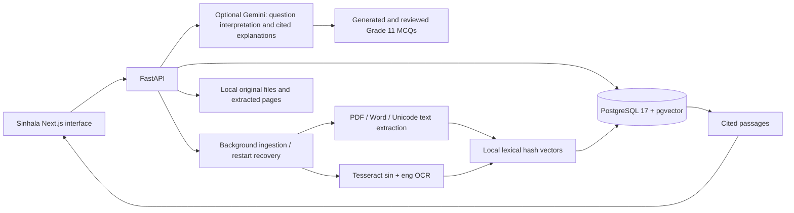

# අකුර · Sinhala study assistant

A bilingual Sinhala/English study workspace for your own notes and past papers. Upload a document, read its extracted text, ask for relevant passages with source links, and practise with scored questions. The original overview-only build has been replaced with working library, reader, question, and practice pages.

## What works

- Upload one or multiple PDF, TXT, MD, DOCX, PNG, JPG/JPEG, or WEBP files, or paste a note directly.
- Store original files and extracted pages locally, with document metadata, chunks, question history, and quizzes in PostgreSQL.
- Track queued, processing, ready, and failed documents. Processing resumes after an API restart; failed documents can be retried or removed.
- Read original PDF pages with their embedded fonts, diagrams, and layout; switch to extracted text for copying. Extract Unicode PDF text and use Tesseract Sinhala + English OCR for scanned PDFs, legacy Sinhala fonts (including FM/DL), and images. Maximum 25 MB per file, 150 pages, and one million extracted characters.
- Search the library by name/subject, filter by subject, read pages, and open original files.
- Ask questions within a subject, one document, or the whole library. Relevant source passages include clickable document/page citations. Unmatched questions return a clear no-match message.
- Generate five standard Grade 11 MCQs with Gemini: complete conceptual questions, four plausible options, one correct answer, and a mix of knowledge, understanding, and application. Each question is checked against its source and reviewed before saving. After submission, see explanations for every option and a source passage.
- Switch the interface between English and Sinhala; the preference persists across tools and reloads. Source text stays in its original language.
- Use a compact study desk, collapsible sidebar with live sources, and a chat composer that stays visible while the conversation scrolls. Select a source or subject in the chat source panel.
- Ask in Sinhala, English, or Singlish (for example, `mkd jiwa pataka kiyanne` or `rudira patakaye karyan mnd`). Preview and edit the Sinhala interpretation before sending. Original and interpreted questions stay in history. Interpretation details expand on demand; source filters apply to history and retrieval.
- Optionally enable server-side Gemini interpretation and Sinhala explanations with numbered source citations; missing keys and provider failures retain local passage answers.
- Dictate an editable Sinhala question in browsers supporting `SpeechRecognition`/`webkitSpeechRecognition`. Dictation never sends the question automatically.
- Responsive Sinhala interface, bundled Noto Sans Sinhala, keyboard focus, reduced-motion support, loading states, and actionable errors.

## Use the app

1. Open **http://localhost:3000/documents**. Choose **ගොනුවක් එක් කරන්න**, select files, and press **ගොනු එක් කරන්න**. Alternatively choose **සටහනක් ලියන්න**, add a title and text, then save.
2. Wait for **සූදානම්**. Scanned documents take longer because every scanned page needs OCR. Failed documents show an explanation and a retry button.
3. Choose **කියවන්න** to read the original PDF page, **හඳුනාගත් අකුරු** for extracted text, or **අකුරු නැවත හඳුනාගන්න** to reprocess an older upload without removing it. Choose **ප්‍රශ්න අහන්න** to ask a question using words from your notes, or **පුහුණු වන්න** to create practice questions.
4. Open an answer's citation to check the original passage. Complete every quiz question and press **ලකුණු බලන්න** for feedback.

For TXT, Markdown, and Word files, citations refer to numbered text sections because those formats do not provide stable original page numbers. PDF citations retain actual PDF page numbers. OCR text should always be checked against the original file.

## Answering mode and limits

The library, reader and local question answering work **without API keys**. Gemini is required for standard MCQ generation. Without Gemini, answers quote relevant passages and Singlish uses spelling aliases and phonetic matching against vocabulary from the selected sources. For example, `rudira patakaye karyan mnd` becomes `රුධිර පටකයේ කාර්යයන් මොනවාද`. Retrieval recognizes common function-word synonyms such as කාර්ය / කෘත්‍ය and selects relevant sections within long OCR pages. Unknown terms can match Sinhala source words through their romanized spellings; ambiguous matches are left for phonetic fallback and the editable preview. Choose Singlish explicitly for unrecognised spellings, or preview/edit the interpretation. Automatic detection is conservative so ordinary English queries remain unchanged. Singlish spellings are ambiguous; conversion is not guaranteed to be correct. A deterministic 1024-dimensional word/character hash index and a lexical relevance check are used locally. This is **not BGE-M3 semantic retrieval**. Queries work best with key terms from the document; synonyms and questions in a different language may not match.

Practice requires `GEMINI_API_KEY` and uses `GEMINI_QUIZ_MODEL` (default `gemini-3.1-flash-lite`). It generates standard Grade 11 MCQs in Sinhala or English using the selected sources. The old missing-word generator has been removed. Insufficient material, provider failures, and rejected questions show an actionable error; they never fall back to missing-word exercises. These are AI-generated practice questions, not official or teacher-approved examination papers. Only the `GEMINI_*` fields enable the optional Gemini provider. Other historical model-related environment fields remain reserved.

OCR is imperfect, especially on handwriting, blur, complex layouts, and legacy Sinhala font encodings. Audio recognition depends on browser, microphone permissions, network, and Sinhala support; the browser's speech service may process audio externally. Typed questions are always available. No audio recording is stored by the app.

There is no authentication or user isolation. The scope is a trusted local shared workspace; services bind to loopback. Public hosting requires a separate authentication and authorization design. Retrieval accuracy has not been benchmarked against a supplied study corpus.

## Optional Gemini setup

1. Add your key to the existing ignored `.env` file (never to frontend code):

   ```dotenv
   GEMINI_API_KEY=your-key-here
   GEMINI_MODEL=gemini-3.8-flash
   GEMINI_QUIZ_MODEL=gemini-3.1-flash-lite
   GEMINI_TIMEOUT_SECONDS=15
   ```

2. Apply the server environment with `docker compose up -d --force-recreate backend`. Merely restarting a container does not reload Compose environment variables.
3. Refresh `/chat`. The banner shows whether Gemini is configured; this indicates a key is present, not that Google has accepted it. Each answer labels its actual mode. Key validation happens on a request.

With a key configured, Singlish/Latin questions may be sent to Google for interpretation. Questions with matching sources send the interpreted question and up to three retrieved excerpts to Google for a Sinhala explanation. Original PDFs and the entire library stay local; only the question and retrieved excerpts are sent to Google. Your API key stays on the server. The preview button can also call Google. Leave the key blank to keep question processing local. Browser dictation has its own external-service behavior described above.

Gemini is prompted to use only the retrieved passages. Responses require valid numbered citations to supplied sources; failed, blocked, truncated, malformed, or invalid-citation responses fall back to verbatim passages with a notice. This validates citation references, not the factual correctness of every generated statement: check the linked original pages. No matching passages means no generated answer. Retrieval remains local and lexical, so paraphrases can still miss relevant sources. Quiz generation uses a separate model and an independent review request. Correct answers, evidence, explanations and distractor feedback stay server-side until submission. Question and answer order vary on each generation; old saved quizzes remain gradeable.

Model and structured-output implementation references: [Google Gemini models](https://ai.google.dev/gemini-api/docs/models/gemini-3.8-flash), [GenerateContent REST reference](https://ai.google.dev/api/generate-content), [structured output](https://ai.google.dev/gemini-api/docs/structured-output). You can change `GEMINI_MODEL` to another compatible text model available to your key. Gemini availability also depends on Google and model capacity. The configured key was accepted by the models endpoint during the interface update, while a generation request returned HTTP 503 (high demand). Local retrieval and Singlish interpretation remained available. The quiz integration separately uses the working `gemini-3.1-flash-lite` model. Provider availability can vary.

## Architecture



## Run locally

Requires Docker Desktop with its Linux engine running and Docker Compose. No local Python, database, or model download is needed. Standard quiz generation needs a Gemini key.

```powershell
Copy-Item .env.example .env
# Set a unique POSTGRES_PASSWORD before the first start.
docker compose up --build -d --wait
Invoke-RestMethod http://localhost:8000/health
```

Open http://localhost:3000. API documentation: http://localhost:8000/docs. Health returns `{"status":"ok","database":"ok"}` when the database, pgvector extension, and migrations are available. Alembic migrations run automatically before the API starts.

Database data lives in the `postgres_data` Docker volume. Original files and extracted text live under `./storage/<document UUID>/`. Preserve both database and storage when backing up. Removing a document deletes its original file and extracted text; past question history retains the quoted answer, and a removed source link returns a clear missing-document message.

```powershell
docker compose ps
docker compose logs --tail 60 backend
docker compose stop
# Remove containers while retaining the database volume:
docker compose down
```

Do not use `docker compose down -v` unless you intend to delete the database. Changing the environment password after initialization does not change an existing database user's password.

Default loopback ports are web `3000`, API `8000`, and PostgreSQL `55432`. When changing ports, update `NEXT_PUBLIC_API_URL`, `CORS_ORIGINS`, and local `DATABASE_URL` consistently, then rebuild the frontend. Compose sets its internal database hostname to `db`. Use a long alphanumeric database password, or URL-encode special characters in the database URL.

For TLS-intercepted networks, both Dockerfiles accept an optional BuildKit secret named `build_ca` containing trusted public CA certificates. The backend also includes these public certificates in its runtime HTTPS trust bundle for Gemini; TLS verification stays enabled. Supply an ignored local Compose override with `build.secrets`; keep certificate verification enabled. On modern Windows Node hosts, `NODE_OPTIONS=--use-system-ca` lets npm use the OS trust store.

## Development and checks

Backend: Python 3.11 (3.12 is also supported). Frontend: Node 22 LTS.

```powershell
docker compose up -d db --wait
py -3.11 -m venv .venv
.\.venv\Scripts\python.exe -m pip install -e './backend[test]'
.\.venv\Scripts\alembic.exe -c backend/alembic.ini upgrade head
.\.venv\Scripts\uvicorn.exe backend.main:app --reload --port 8000
# Separate terminal:
cd frontend
npm ci
npm run dev
```

Local image/scan ingestion also requires Tesseract with `sin` and `eng` on PATH; the Docker image includes them. Production Linux dependencies are pinned in `backend/requirements.lock`; npm dependencies are locked in `frontend/package-lock.json`.

```powershell
docker compose exec backend sh -c 'APP_ENV=test TEST_DATABASE_URL=$DATABASE_URL python -m pytest backend/tests -q'
docker compose exec backend alembic -c backend/alembic.ini check
cd frontend
npm run test
npm run typecheck
npm run build
# With the rebuilt Docker application running:
npx playwright install chromium
npm run test:e2e
```

Live API workflow tests use uniquely named disposable databases and temporary storage. Existing schema checks roll back their test records. Browser tests start an isolated API on loopback port `8001`, with a disposable database and storage volume, and exercise the real production frontend on port `3000`. They clean up their test API, volume, and database afterward. Browser screenshots are saved under ignored `.artifacts/qa/`; failure screenshots and context are under `frontend/test-results/`.

See [workflow verification](docs/workflows.md) for tested behavior and remaining limits. [Phase 1 evidence](docs/phase-1.md) is a historical record of the original foundation.


## Standard MCQ practice

Select a source or subject, choose Sinhala or English under **Question language**, and start practice. The server samples passages across the chapter and sends only that bounded content to Gemini. Each test has five questions and four options per question; at most two are recall questions, at least two target understanding, and at least one describes an application scenario. Correct answers are shuffled with their option explanations.

Validation rejects missing-word stems, duplicate questions/options, invalid answer indices, invalid sources, ungrounded evidence, and a missing skill mix. A second Gemini call reviews question clarity, the answer key, source support, and distractor plausibility. A quote may be recovered from a substantial verbatim span when the model uses an original page number or an ellipsis; the displayed quote is always taken from the actual source text. These checks reduce poor output but do not guarantee factual correctness or official syllabus alignment. Verify important facts against the cited page.

Generation and review have 30-second and 20-second provider timeouts. If a key, service, or quality check fails, the app asks you to retry or choose more material. It does not generate a lower-quality fallback. Quiz questions, answers and feedback are saved in PostgreSQL; no migration is needed. Existing saved quizzes are retained.
