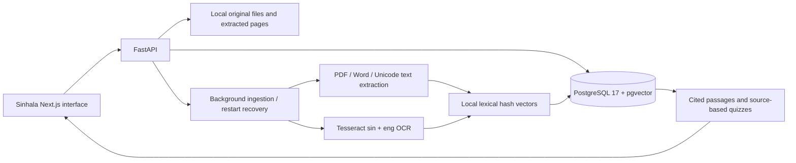

# අකුර · Sinhala study assistant

A shared Sinhala study workspace for your own notes and past papers. Upload a document, read its extracted text, ask for relevant passages with source links, and practise with scored questions. The original overview-only build has been replaced with working library, reader, question, and practice pages.

## What works

- Upload one or multiple PDF, TXT, MD, DOCX, PNG, JPG/JPEG, or WEBP files, or paste a note directly.
- Store original files and extracted pages locally, with document metadata, chunks, question history, and quizzes in PostgreSQL.
- Track queued, processing, ready, and failed documents. Processing resumes after an API restart; failed documents can be retried or removed.
- Extract Unicode PDF text and use Tesseract Sinhala + English OCR for scanned PDFs and images. Maximum 25 MB per file, 150 pages, and one million extracted characters.
- Search the library by name/subject, filter by subject, read pages, and open original files.
- Ask questions within a subject, one document, or the whole library. Relevant source passages include clickable document/page citations. Unmatched questions return a clear no-match message.
- Create up to five multiple-choice fill-in-the-blank questions from actual source sentences. The server grades answers and returns explanations and source links after submission.
- Dictate an editable Sinhala question in browsers supporting `SpeechRecognition`/`webkitSpeechRecognition`. Dictation never sends the question automatically.
- Responsive Sinhala interface, bundled Noto Sans Sinhala, keyboard focus, reduced-motion support, loading states, and actionable errors.

## Use the app

1. Open **http://localhost:3000/documents**. Choose **ගොනුවක් එක් කරන්න**, select files, and press **ගොනු එක් කරන්න**. Alternatively choose **සටහනක් ලියන්න**, add a title and text, then save.
2. Wait for **සූදානම්**. Scanned documents take longer because every scanned page needs OCR. Failed documents show an explanation and a retry button.
3. Choose **කියවන්න** to read, **ප්‍රශ්න අහන්න** to ask a question using words from your notes, or **පුහුණු වන්න** to create practice questions.
4. Open an answer's citation to check the original passage. Complete every quiz question and press **ලකුණු බලන්න** for feedback.

For TXT, Markdown, and Word files, citations refer to numbered text sections because those formats do not provide stable original page numbers. PDF citations retain actual PDF page numbers. OCR text should always be checked against the original file.

## Answering mode and limits

The app works **without API keys**. Its current answering mode finds and quotes relevant passages; it does not invent explanations or run a generative AI model. A deterministic 1024-dimensional word/character hash index and a lexical relevance check are used locally. This is **not BGE-M3 semantic retrieval**. Queries work best with key terms from the document; synonyms and questions in a different language may not match.

Practice questions are source-based cloze exercises, not AI-generated exam papers. Very short notes may provide fewer than five questions or not enough material for a quiz. Existing model-related environment fields are reserved for future integrations and do not enable an AI provider.

OCR is imperfect, especially on handwriting, blur, complex layouts, and legacy Sinhala font encodings. Audio recognition depends on browser, microphone permissions, network, and Sinhala support; the browser's speech service may process audio externally. Typed questions are always available. No audio recording is stored by the app.

There is no authentication or user isolation. The scope is a trusted local shared workspace; services bind to loopback. Public hosting requires a separate authentication and authorization design. Retrieval accuracy has not been benchmarked against a supplied study corpus.

## Architecture



## Run locally

Requires Docker Desktop with its Linux engine running and Docker Compose. No local Python, database, model download, or API key is needed.

```powershell
Copy-Item .env.example .env
# Set a unique POSTGRES_PASSWORD before the first start.
docker compose up --build -d --wait
Invoke-RestMethod http://localhost:8000/health
```

Open http://localhost:3000. API documentation: http://localhost:8000/docs. Health returns `{"status":"ok","database":"ok"}` when the database, pgvector extension, and migrations are available. Alembic migrations run automatically before the API starts.

Database data lives in the `postgres_data` Docker volume. Original files and extracted text live under `./storage/<document UUID>/`. Preserve both database and storage when backing up. Removing a document deletes its original file and extracted text; past question history retains the quoted answer, and a removed source link returns a clear missing-document message.

```powershell
docker compose ps
docker compose logs --tail 60 backend
docker compose stop
# Remove containers while retaining the database volume:
docker compose down
```

Do not use `docker compose down -v` unless you intend to delete the database. Changing the environment password after initialization does not change an existing database user's password.

Default loopback ports are web `3000`, API `8000`, and PostgreSQL `55432`. When changing ports, update `NEXT_PUBLIC_API_URL`, `CORS_ORIGINS`, and local `DATABASE_URL` consistently, then rebuild the frontend. Compose sets its internal database hostname to `db`. Use a long alphanumeric database password, or URL-encode special characters in the database URL.

For TLS-intercepted networks, both Dockerfiles accept an optional BuildKit secret named `build_ca` containing trusted public CA certificates. Supply an ignored local Compose override with `build.secrets`; keep certificate verification enabled. On modern Windows Node hosts, `NODE_OPTIONS=--use-system-ca` lets npm use the OS trust store.

## Development and checks

Backend: Python 3.11 (3.12 is also supported). Frontend: Node 22 LTS.

```powershell
docker compose up -d db --wait
py -3.11 -m venv .venv
.\.venv\Scripts\python.exe -m pip install -e './backend[test]'
.\.venv\Scripts\alembic.exe -c backend/alembic.ini upgrade head
.\.venv\Scripts\uvicorn.exe backend.main:app --reload --port 8000
# Separate terminal:
cd frontend
npm ci
npm run dev
```

Local image/scan ingestion also requires Tesseract with `sin` and `eng` on PATH; the Docker image includes them. Production Linux dependencies are pinned in `backend/requirements.lock`; npm dependencies are locked in `frontend/package-lock.json`.

```powershell
docker compose exec backend sh -c 'APP_ENV=test TEST_DATABASE_URL=$DATABASE_URL python -m pytest backend/tests -q'
docker compose exec backend alembic -c backend/alembic.ini check
cd frontend
npm run test
npm run typecheck
npm run build
# With the rebuilt Docker application running:
npx playwright install chromium
npm run test:e2e
```

Live API workflow tests use uniquely named disposable databases and temporary storage. Existing schema checks roll back their test records. Browser tests start an isolated API on loopback port `8001`, with a disposable database and storage volume, and exercise the real production frontend on port `3000`. They clean up their test API, volume, and database afterward. Browser screenshots are saved under ignored `.artifacts/qa/`; failure screenshots and context are under `frontend/test-results/`.

See [workflow verification](docs/workflows.md) for tested behavior and remaining limits. [Phase 1 evidence](docs/phase-1.md) is a historical record of the original foundation.
